<p align="center">
  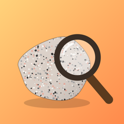
</p>

<h1 align="center">Rock Detective</h1>

<p align="center">
  <b>Snap a rock. Find the clues. Crack the case!</b><br>
  A kid-friendly iPad app that identifies rocks on the device, works offline, and is honest about how sure it is.
</p>

<p align="center">
  
  
  
  
  
</p>

<p align="center">
  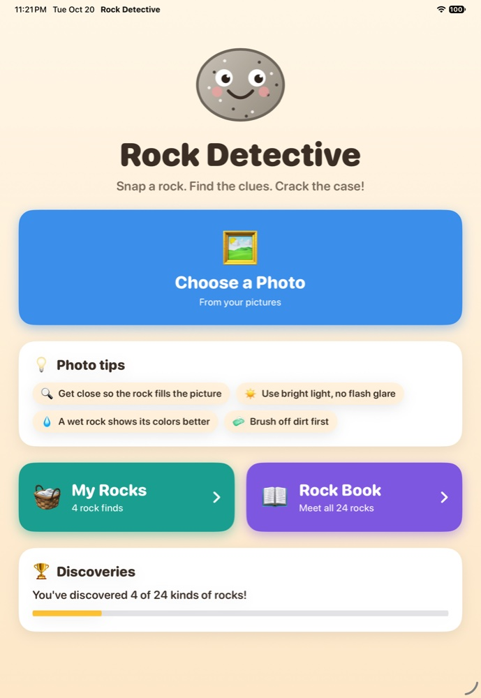
  &nbsp;
  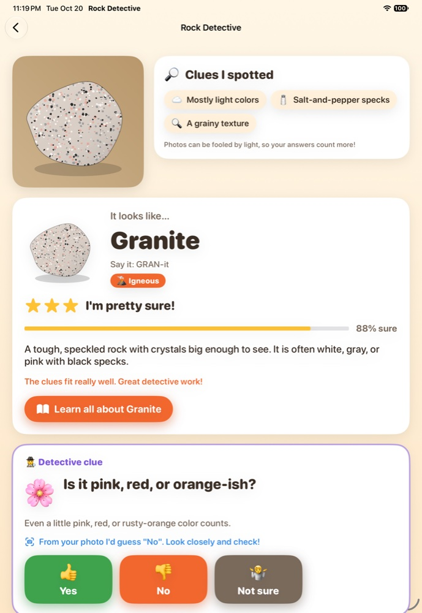
  &nbsp;
  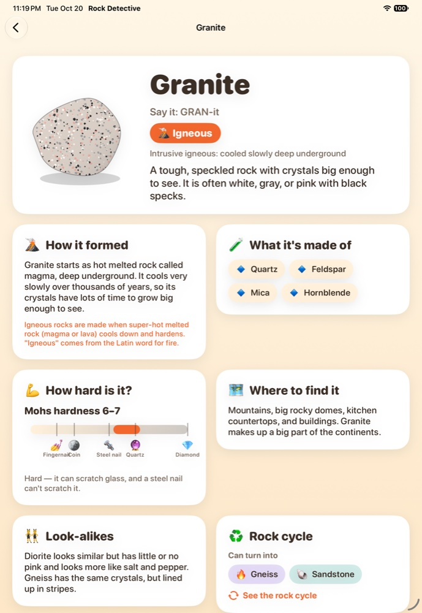
</p>

---

## Why Rock Detective?

Kids pick up rocks everywhere: on hikes, at the beach, in the backyard. Many rock-ID apps upload the photo to a cloud service and answer with a name. That's a poor fit for children: their photos leave the device, the app needs a signal, and a confident-looking answer can hide how hard rock identification really is.

Rock Detective takes the approach a geologist uses with a hand sample:

1. **Look closely.** The app reads clues from the photo: color, grains, salt-and-pepper specks, layers, and glassy shine.
2. **Test it.** It asks a few simple, kid-safe questions, choosing the most useful one each time. Does it fizz with vinegar? Can a steel nail scratch it? Does it float?
3. **Weigh the evidence.** A Bayesian model combines everything, ranks 24 rocks, and says how sure it is: *"Just a hunch…"*, *"Good guess!"*, or *"I'm pretty sure!"*, always alongside *"Could also be…"*.

Kids get an answer in seconds, and they learn the real tests scientists use along the way.

## How it works for kids

| 1. Snap or choose a photo | 2. See the first guess | 3. Answer detective clues | 4. Build a collection |
|:---:|:---:|:---:|:---:|
|  | 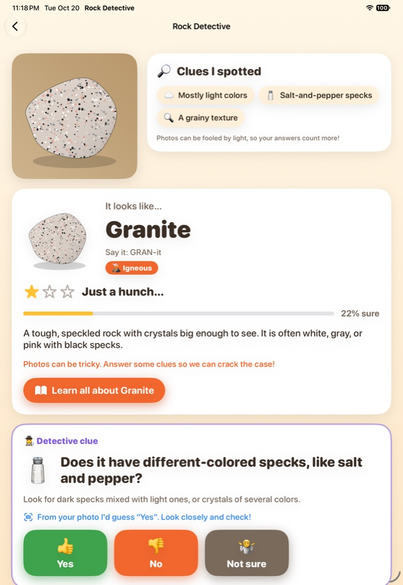 | 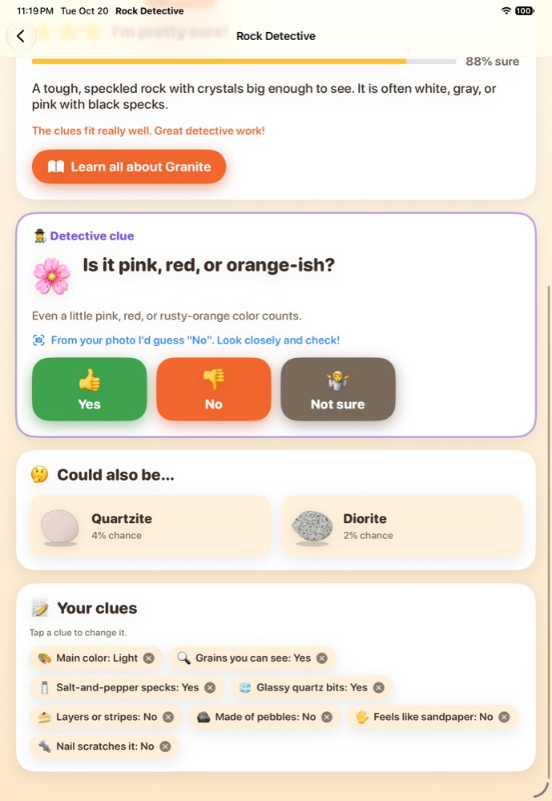 | 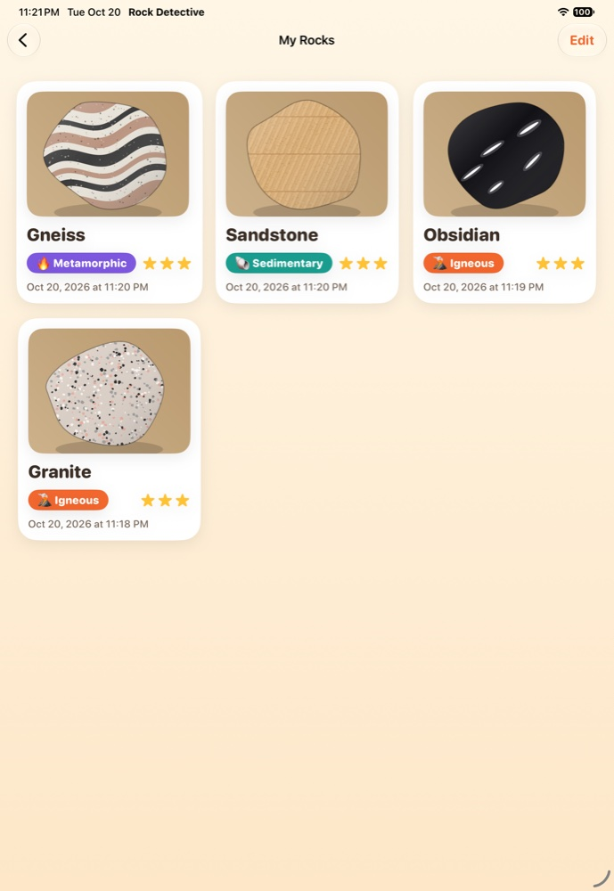 |
| Big buttons. Photo tips: get close, use good light, wet the rock to see its colors. | The app lists the clues it spotted in the photo and gives an honest first guess. | Each answer re-ranks the rocks instantly. If the photo already hints at an answer, the app says so and asks the kid to check. | Every find is saved with its photo, so kids can come back and keep investigating. |

### More screens

| Rock Book | Rock Cycle | Dark mode |
|:---:|:---:|:---:|
| 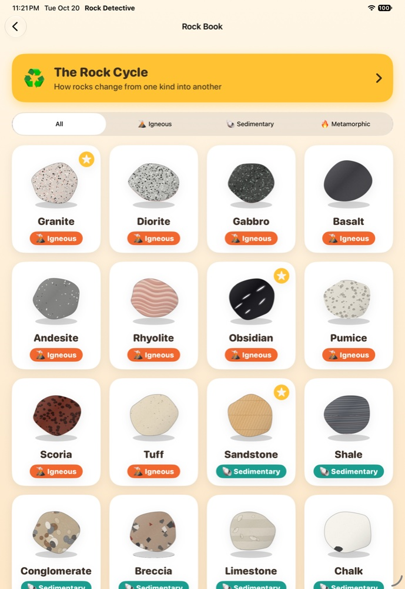 | 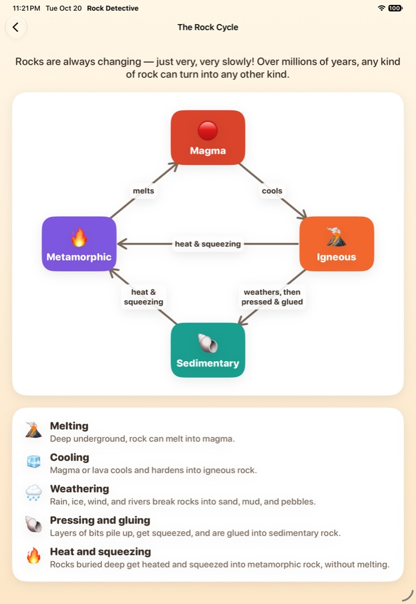 | 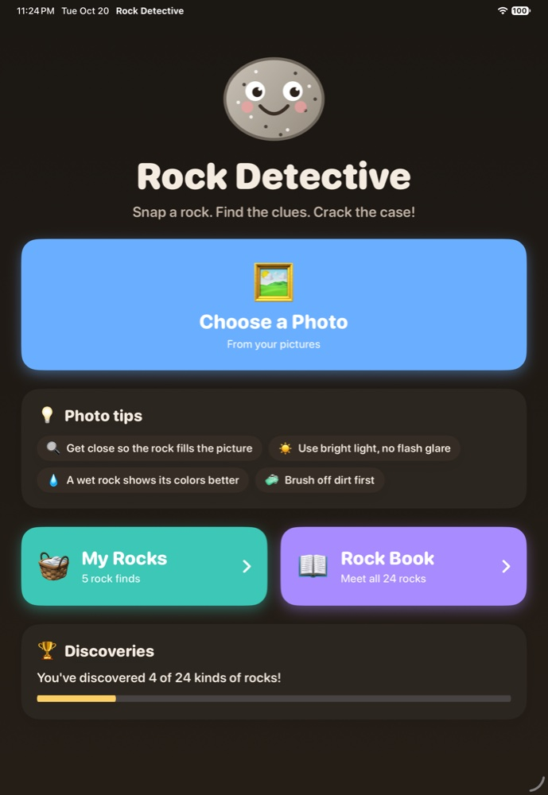 |

<p align="center">
  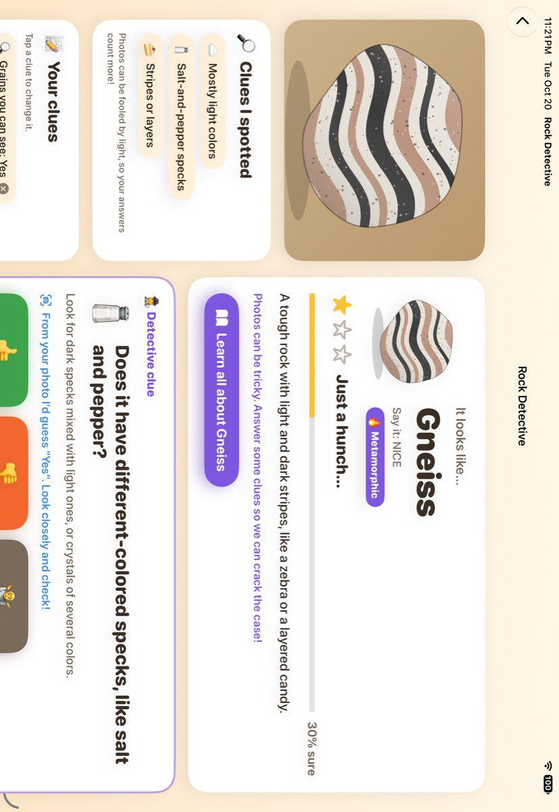
  <br><sub>Landscape uses two columns: the photo and its clues on the left, the answer and the next clue on the right.</sub>
</p>

## Features

- 📷 **Camera or photo library.** Take a picture or pick one you already have.
- 🔎 **Photo clues.** Color tone, warm hue, visible grains, specks, layers, and glassy shine, described in kid language.
- 🕵️ **Adaptive "20 questions".** The next clue is the one expected to teach the most (largest information gain), with a small discount for tests that need a tool. Follow-up questions stay on topic ("made of pebbles?" leads to "are the pebbles round?").
- ⭐ **Honest confidence.** Stars, a percentage, and the two most likely look-alikes on every result.
- 📖 **Rock Book.** All 24 rocks, how to say each name, how it formed, minerals, a Mohs hardness scale with everyday objects, where to find it, fun facts, and rock-cycle links.
- ♻️ **Rock Cycle.** How magma, igneous, sedimentary, and metamorphic rocks turn into one another.
- 🧺 **My Rocks.** A saved collection with discovery progress ("You've discovered 4 of 24 kinds of rocks!").
- 🛡️ **Safety built in.** Tests that need vinegar or a nail say "ask a grown-up"; obsidian and chert pages warn about sharp edges.
- 🎨 **Every rock is drawn by code.** Each rock's real texture (speckles, bands, bubble holes, pebbles, fossils) is drawn by a deterministic Core Graphics renderer, so no licensed images are needed.
- ♿ **Kid- and accessibility-minded.** Large text and tap targets, VoiceOver labels, light and dark mode, and Reduce Motion support.

<p align="center">
  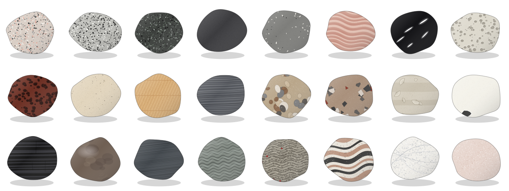
  <br><sub>All 24 rocks, each drawn procedurally to show the texture that identifies it.</sub>
</p>

## The 24 rocks

| 🌋 Igneous: cooled from melted rock | 🐚 Sedimentary: bits pressed and glued together | 🔥 Metamorphic: changed by heat and squeezing |
|---|---|---|
| Granite · Diorite · Gabbro | Sandstone · Shale · Conglomerate · Breccia | Slate · Phyllite · Schist · Gneiss |
| Basalt · Andesite · Rhyolite | Limestone · Chalk | Marble · Quartzite |
| Obsidian · Pumice · Scoria · Tuff | Coal · Chert (Flint) | |

The content was written for ages 6–12 and checked for scientific accuracy. Some of the rules the tests enforce:

- Only carbonate rocks (limestone, chalk, marble) fizz strongly with acid.
- Hardness follows mineralogy: quartzite and chert resist a steel nail (Mohs ≈ 5.5); limestone, chalk, and coal don't.
- Only pumice usually floats, and igneous rocks essentially never contain fossils.
- Rock-cycle links run both ways (shale → slate → phyllite → schist → gneiss, limestone → marble, sandstone → quartzite).

## Under the hood

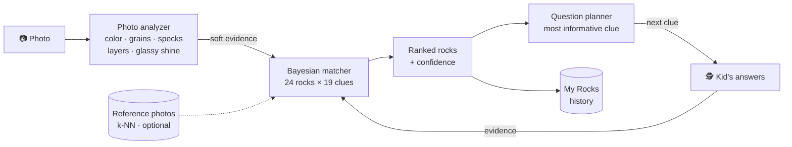

**Knowledge base.** [`rocks.json`](Packages/RockKit/Sources/RockKit/Resources/rocks.json) holds the kid-facing content for each rock and a likelihood table for 19 observable clues, for example P(fizzes with vinegar | limestone) ≈ 0.9. The catalog is validated on load: probabilities, hardness ranges, and rock-cycle links.

**Photo analysis.** This runs on a centered square crop whose side is 60% of the photo's shorter edge, scaled down to 160×160 pixels, in about 50 ms. The cues are physically motivated:

| Cue | How it's measured | What it suggests |
|---|---|---|
| Color tone | Median brightness | Light felsic rocks vs dark mafic rocks |
| Warm hue | Share of clearly pink, red, or orange pixels | Pink feldspar, iron oxide |
| Grains | Local contrast (5×5 std. dev.), discounted where it lines up | Visible crystals or sand grains |
| Specks | Pixels far from their 9×9 neighborhood | Salt-and-pepper minerals |
| Layers | Block-normalized structure-tensor coherence | Bedding, foliation, banding |
| Glassy shine | Bright, colorless highlights on a darker body | Volcanic glass, waxy chert |

Photo cues are deliberately **soft**: yes/no beliefs stay between 0.2 and 0.8 and are down-weighted, because lighting fools cameras. When a kid answers a clue, their answer replaces the photo's guess for that clue.

**Matching.** A naive Bayes classifier with virtual evidence:

```text
log score(rock) = log prior(rock)                                    # how common the rock is
                + Σ answered clues  log P_ε(answer | rock)           # 8% "kid mistake" mix
                + 0.7 · Σ photo cues  log Σ_v P(v | rock) · q(v)      # soft photo evidence
                + 0.6 · log P(reference neighbors | rock)             # optional k-NN
posterior = softmax(log scores)
```

**Choosing the next question.** For every question still worth asking, the planner computes the expected drop in the entropy of the posterior. It discounts tests that need a tool, boosts follow-ups that were just unlocked, and stops at 90% confidence.

**Picture matching hook.** `ReferenceMatcher` runs distance-weighted k-nearest neighbors over Apple Vision feature prints. It switches on automatically if a licensed reference photo set is bundled under `ReferenceSamples/<rockID>/`. No photo set ships yet; see the [roadmap](#roadmap).

The full research (cloud API vs local data, licensing, privacy rules for kids' apps), the algorithm choices, and the predefined test plan are in **[docs/DESIGN.md](docs/DESIGN.md)**.

## Accuracy and speed

Measured by the test suite with simulated kids. For each rock, a simulated kid answers every clue by drawing from that rock's probabilities in the catalog, so a simulated granite isn't always pink. There are 200 kids per rock for the all-clues rows and 50 per rock for the five-question rows. These kids never make mistakes and the matcher's model is exactly right by construction, so the numbers show how well the clues can tell rocks apart. They are not a real-world accuracy figure:

| Scenario | Top-1 | Top-3 |
|---|---|---|
| Bayes-optimal for this simulation (exact probabilities, every rock equally likely), all clues answered | 69.0% | 91.8% |
| **Rock Detective**, all clues answered | **67.3%** | **91.1%** |
| Rock Detective, 5 adaptive questions | 46.5% | 73.1% |
| 5 random questions, for comparison | 23.0% | 49.2% |

The matcher is within two points of the best any classifier can do on this simulation. The small gap is deliberate: the app favors rocks that are common where kids look, and it allows for wrong answers. Even the best possible classifier tops out near 69%, because the rocks that remain confused are the ones geologists also mix up in hand samples: diorite, granite and gabbro; basalt and andesite; shale and slate; chert and obsidian; limestone and marble. That's why every result shows its look-alikes.

| Step (debug build, iPad simulator) | Time | Test budget |
|---|---|---|
| Score all rocks with every clue | 0.5 ms | < 1 ms |
| Pick the next question | 1.5 ms | < 5 ms |
| Analyze a photo | ~50 ms | < 150 ms |
| Decode and downsample a 12 MP photo | ~70 ms | < 300 ms |

> Photo-only accuracy has only been measured on the app's own illustrations so far, where the right rock lands in the top 5 for 21 of 24. Calibrating against a labeled set of real field photos is the most important next step.

## Privacy

- No network access, accounts, ads, analytics, or third-party SDKs.
- Photos stay on the iPad: they're saved downscaled (≤ 1024 px) in the app's own storage and can be deleted in **My Rocks**.
- The only permission is the camera, and the photo library goes through the system picker, which needs no permission.

It was designed around the App Store's rules for kids' apps (guidelines 1.3 and 5.1.4), which restrict sending children's data to third parties. Publishing in the Kids Category would also need a privacy policy.

## Getting started

**Requirements:** macOS with Xcode. It was developed and tested with Xcode 27.0 and the iPadOS 27 simulator. The deployment target is iPadOS 17.

```bash
git clone https://github.com/Tonylic/rock-detective.git
```

```bash
open rock-detective/RockID.xcodeproj
```

Choose the **RockID** scheme and an iPad simulator, then press Run. To run on a real iPad (needed for the camera), first pick your own team under **Signing & Capabilities** for the RockID target, and change the bundle identifier if Xcode says it's unavailable.

> **Tip for the simulator (no camera):** launch the app with `-practiceRock granite` (any rock id from `rocks.json` works). A **Practice Rock** button appears that sends a drawn "photo" of that rock through the real identification flow. Add `-uiTesting -resetHistory` to use a separate, freshly cleared collection.

## Testing

One command runs all 83 RockKit tests on macOS and on the iPad simulator, then the 4 UI tests on the simulator:

```bash
scripts/test-all.sh
```

| Suite | Tests | What it covers |
|---|---:|---|
| Knowledge base | 17 | Catalog integrity, plus the science rules above |
| Matcher | 14 | 15 classic field-test combinations, robustness to mistakes, simulated accuracy vs the Bayes-optimal classifier |
| Question planner | 8 | Information gain, follow-ups, stopping, adaptive vs random |
| Photo analysis | 19 | Synthetic images (stripes, specks, glare), practice photos, image loading and EXIF orientation |
| Reference matcher | 7 | k-NN voting, smoothing, Vision feature prints* |
| History | 9 | Save and reload, ordering, delete, recovery from a corrupt file |
| Session | 5 | Photo → answers → saved find → reopen |
| Performance | 4 | The four timings above, each held to its budget |
| UI (XCUITest) | 4 | Launch, identify, answer, persist across relaunch, delete, Rock Book, learn more |

<sub>*The Vision feature-print test runs on macOS and is skipped on the iOS simulator, which doesn't include the feature-print model.</sub>

For logic-only changes there's a faster loop: `swift test --package-path Packages/RockKit`.

## Project structure

```text
RockID/                     SwiftUI app (iPad)
├── App/                    Entry point, AppModel, launch options
├── Views/                  Home, Identify, Rock page, Rock Book, Rock Cycle, My Rocks, mascot
└── Support/                Theme, camera picker, rock-art view
RockIDUITests/              End-to-end UI tests
Packages/RockKit/           All logic as a Swift package (Swift 6, strict concurrency)
├── Sources/RockKit/
│   ├── Catalog/            Rock, ClueQuestion, RockCatalog (+ Resources/rocks.json)
│   ├── Engine/             RockMatcher, QuestionPlanner, ReferenceMatcher, RockIdentifier
│   ├── Imaging/            PhotoAnalyzer, ImageLoader, FeaturePrinter, photo clues
│   ├── Art/                RockArtRenderer (procedural illustrations)
│   ├── History/            HistoryStore (JSON + JPEG files)
│   └── Session/            IdentificationSession (@Observable view model)
└── Tests/RockKitTests/     Swift Testing suites
docs/DESIGN.md              Research, design, test plan, results
scripts/test-all.sh         Runs every test
```

## Roadmap

- **Reference photo gallery.** A curated, license-checked set of real rock photos (for example, public-domain USGS images) to switch on the k-NN picture matcher, then a Create ML classifier once there are enough photos per rock.
- **Real-world calibration** of the photo cues against labeled field photos.
- **Minerals and gems:** quartz crystals, pyrite, mica, and more.
- **More languages.**

## A note for grown-ups

Some detective clues use a little vinegar or a steel nail. The app marks these "ask a grown-up" and explains how to do them safely. Never taste rocks, and handle obsidian and broken chert carefully because the edges can be very sharp.
